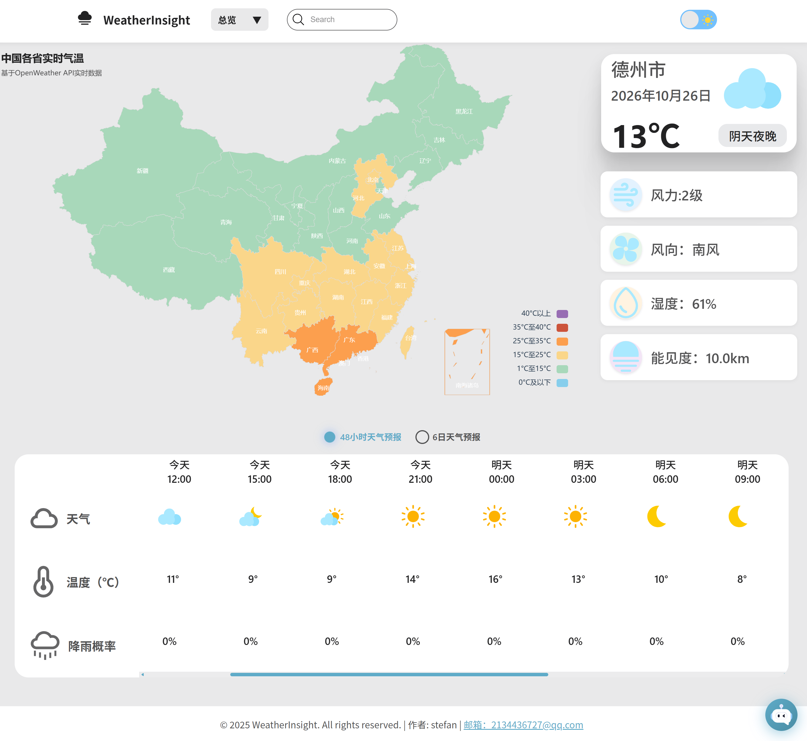
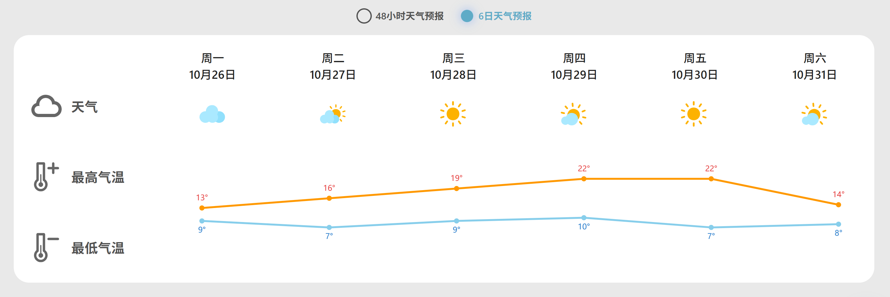
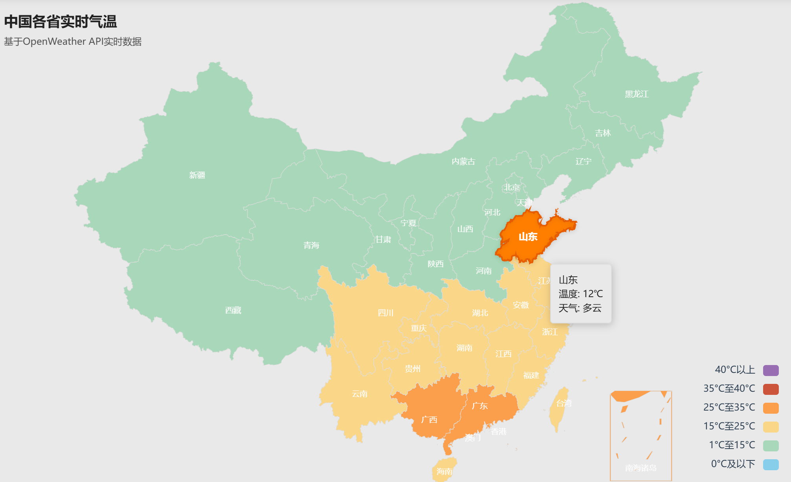
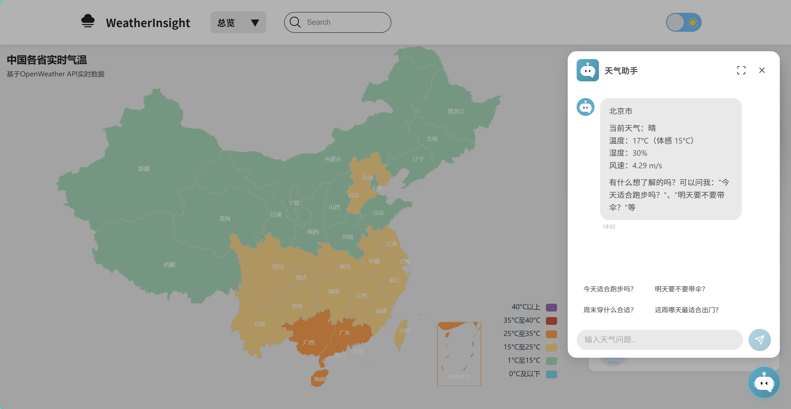
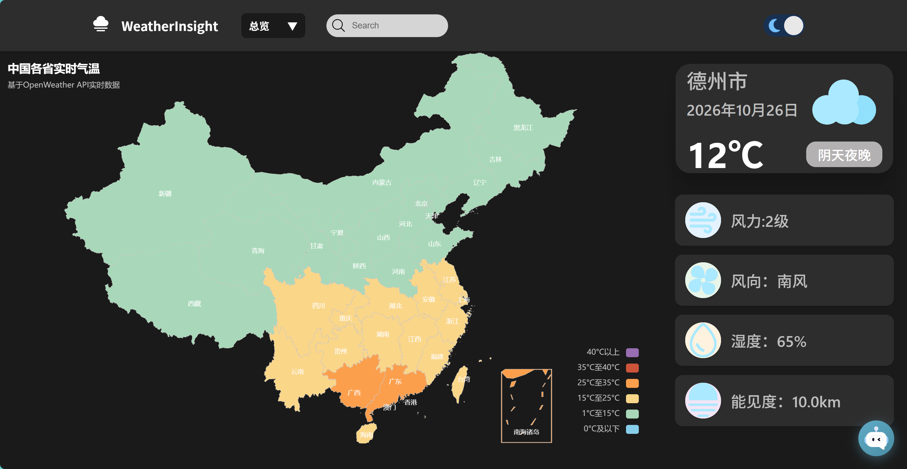
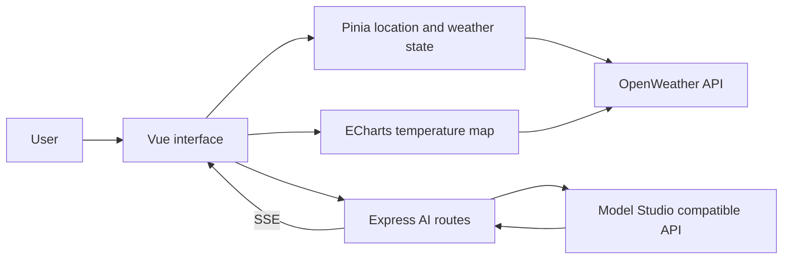

# WeatherInsight

**Weather data, readable trends, regional maps, and everyday advice in one place.**

[简体中文](README.md) · **English**

[Live demo](https://weather-iota-green.vercel.app) · [Highlights](#highlights) · [Features](#features) · [Screenshots](#screenshots) · [Run locally](#run-locally)

WeatherInsight is a full-stack weather visualization web application built with Vue 3 and Express and accessed through a browser. It brings city weather summaries, short-term forecasts, a temperature map of China, and AI chat into one web interface. The application is designed for Chinese-language use, with city search, browser geolocation, light and dark themes, and responsive layouts for different browser viewport widths.

`Vue 3` · `Vite` · `Pinia` · `ECharts` · `TypeScript` · `Express`

## Highlights

### Weather summaries, trends, and regional context together

Cards present city weather and key metrics, line charts show daily temperature highs and lows, and a shaded map shows regional differences. Users can move from local conditions to upcoming changes and temperatures elsewhere without leaving the dashboard.

### A map that fills in as data arrives

Map weather requests run in batches of up to **5 concurrent requests**. The chart updates after each batch, so available results appear before every region finishes loading. Users can pan, zoom, and hover over regions for weather details.

### One forecast request, several useful views

The main city weather flow reuses one forecast response to build the weather summary, the next **48 hours in 3-hour intervals**, and daily temperature highs and lows. City data is stored in `localStorage` by coordinates for **10 minutes**, reducing repeated requests over short periods.

### Streaming AI replies with visible failure states

The Express backend sends model output through **SSE**, with heartbeat messages. Chat supports conversation history, cancellation, timeout feedback, and visible errors. Replies appear as text while streaming and render as Markdown when complete. The model and compatible API endpoint are configurable through backend environment variables.

### Location fallbacks that keep the page usable

The app first tries browser geolocation. If reverse geocoding fails, it keeps the coordinates for weather retrieval. A default city is used when location lookup fails or times out, and manual search remains available. Location, weather, and chat have their own loading and error states.

### Clear boundaries for maintenance and extension

Pinia manages location and weather state, Composables contain chat and rendering logic, and Express separates routes from model services. Zod validates request bodies. Theme changes apply to both the interface and the map, and the selected preference is restored on the next visit.

## Features

| Feature | What it offers |
| --- | --- |
| City search and geolocation | Search by city name or use browser location, with Chinese city names where available |
| Weather overview | Temperature, weather icons, feels-like temperature, humidity, wind speed and direction, pressure, and visibility |
| 48-hour forecast | Weather, temperature, and precipitation probability in 3-hour intervals, with horizontal browsing |
| Daily temperature trends | Daily highs and lows, weather icons, and a temperature line chart |
| China temperature map | Temperature bands, panning, zooming, and hover details |
| AI weather assistant | Floating chat, suggested questions, conversation history, streaming replies, and cancellation |
| Light and dark themes | Manual switching, system preference on the first visit, and a saved theme choice |
| Responsive layout | Cards, forecast sections, and chat adjust to the browser viewport width |

## Screenshots

### 01 · Weather dashboard



### 02 · Forecasts and temperature trends



### 03 · Regional temperature map



### 04 · AI weather assistant



### 05 · Light and dark themes



## Technology and data flow

| Layer | Technology and purpose |
| --- | --- |
| Interface | Vue 3, Composition API, Vue Router |
| State | Pinia for location, weather, loading, and error state |
| Visualization | ECharts for temperature line charts and the regional map |
| Build tooling | Vite |
| Backend | Node.js, Express, TypeScript |
| Request validation | Zod |
| AI integration | OpenAI SDK calling the Model Studio compatible API, with SSE chat output |
| Weather and location data | OpenWeather forecast, weather, and geocoding APIs |
| Text rendering | Marked, streaming text display, and updates batched with `requestAnimationFrame` |



The frontend requests weather from OpenWeather directly. AI requests go through Express to the model provider. `VITE_AI_API_URL` determines whether chat uses the local or deployed backend.

## Run locally

### 1. Install prerequisites and dependencies

Use a Node.js version matching `^20.19.0 || >=22.12.0`. You also need an OpenWeather API key and a Model Studio API key authorized for your selected model.

```bash
git clone https://github.com/stefan-213/weather.git
cd weather
npm install
npm --prefix server install
```

### 2. Configure the frontend

Create `.env.development.local` in the project root:

```dotenv
VITE_OPENWEATHER_API_KEY=your_openweather_api_key
VITE_AI_API_URL=http://localhost:3001
```

### 3. Configure the backend

Copy `server/.env.example` to `server/.env` and configure:

```dotenv
PORT=3001
DASHSCOPE_API_KEY=your_dashscope_api_key
DASHSCOPE_MODEL=your_authorized_model_id
DASHSCOPE_BASE_URL=https://dashscope.aliyuncs.com/compatible-mode/v1
```

Set `DASHSCOPE_MODEL` to a model ID authorized for your key. The endpoint must match the key's region and service type. Keep the model API key in the backend configuration without a `VITE_` prefix.

### 4. Start both services

In the first terminal, run the frontend from the project root:

```bash
npm run dev
```

In a second terminal, run the backend from the project root:

```bash
npm --prefix server run dev
```

| Address | Purpose |
| --- | --- |
| `http://localhost:5173` | Frontend application |
| `http://localhost:3001/health` | Backend health check; returns `status: "ok"` when available |

Restart the backend after editing `server/.env`; the current `tsx watch` setup does not reload that file automatically. Restart Vite after changing frontend environment variables as well.

### 5. Build and check

Run from the project root:

```bash
npm run build
npm --prefix server run build
node --test tests/stream-chat.test.mjs
```

Frontend output is written to `dist/`, and backend output to `server/dist/`. After building the backend, start it with `npm --prefix server start`. Chat regression tests cover successful streaming, permission errors, empty responses, interrupted streams, and HTTP errors.

## Project structure

```text
WeatherInsight/
├── src/
│   ├── components/       # Weather cards, map, search, and AI chat
│   ├── composables/      # Streaming chat, text rendering, weather icons
│   ├── stores/           # Pinia location and weather state
│   ├── views/            # Dashboard and visualization placeholder
│   ├── workers/          # Map Worker message handlers
│   └── router/           # Frontend routes
├── server/
│   ├── src/routes/       # AI endpoints and request validation
│   ├── src/services/     # Model requests and weather prompts
│   ├── src/app.ts        # Express entry point and health check
│   └── .env.example      # Backend configuration example
├── tests/                # Streaming chat regression tests
├── docs/images/          # README screenshots and image instructions
├── README.md             # Chinese documentation
└── README.en.md          # English documentation
```

