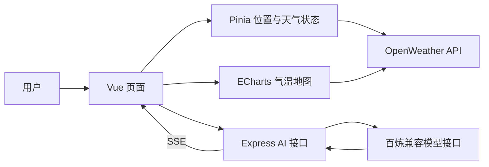

# WeatherInsight

**把天气数据变成看得懂的趋势、地图与日常建议。**

**简体中文** · [English](README.en.md)

[在线体验](https://weather-iota-green.vercel.app) · [项目亮点](#项目亮点) · [主要功能](#主要功能) · [界面预览](#界面预览) · [本地运行](#本地运行)

WeatherInsight 是一个基于 Vue 3 和 Express 的全栈天气可视化 Web 应用，通过浏览器访问，将城市天气概览、短期预报、全国气温分布和 AI 对话整合在一个网页中。项目面向中文使用场景，支持城市搜索、浏览器定位、明暗主题，以及适配不同浏览器窗口宽度的响应式布局。

`Vue 3` · `Vite` · `Pinia` · `ECharts` · `TypeScript` · `Express`

## 项目亮点

### 一屏串联天气概览、趋势与地域差异

卡片展示城市天气与关键指标，折线图呈现每日高低温变化，分区着色地图展示不同地区的温度。用户可以从“当地天气怎么样”继续查看“接下来如何变化”和“其他地区冷不冷”。

### 地图分批加载，数据到达即可展示

地图天气请求按每批最多 **5 个并发**执行，每完成一批就更新图表。无需等待全部地区请求完成，已获取的数据就能先呈现在地图上；地图支持拖动、缩放和悬浮查看天气详情。

### 一次预报请求，多种数据视图

城市天气的主加载流程复用同一份预报响应，整理出天气概览、未来 **48 小时 / 每 3 小时**的预报，以及按日期汇总的高低温。城市数据按经纬度写入 `localStorage`，有效期 **10 分钟**，减少短时间内重复请求。

### AI 回复流式呈现，失败也有明确反馈

Express 后端通过 **SSE** 将模型输出逐段传回前端，并发送心跳消息。聊天支持会话上下文、停止生成、超时提示和错误展示；生成过程中先显示文本，结束后呈现 Markdown 排版。模型名称与兼容接口地址可通过后端环境变量配置。

### 定位失败后仍可继续使用

优先通过浏览器定位，反向地理编码失败时保留坐标继续获取天气；定位失败或超时后使用默认城市，并保留手动搜索入口。位置、天气、聊天分别管理加载和错误状态。

### 前后端分层，便于阅读与扩展

Pinia 管理位置与天气状态，Composables 封装聊天和渲染逻辑，Express 将路由与模型服务分开，Zod 校验请求体。明暗主题同步作用于界面和地图，主题偏好可在下次访问时恢复。

## 主要功能

| 功能 | 使用体验 |
| --- | --- |
| 城市搜索与定位 | 输入城市名称查询，也可使用浏览器定位；城市名称优先展示中文 |
| 天气概览 | 展示温度、天气图标、体感温度、湿度、风速风向、气压和能见度 |
| 48 小时预报 | 以 3 小时为间隔展示温度、天气状况和降水概率，支持横向浏览 |
| 多日天气趋势 | 按日期汇总最高 / 最低温度，结合天气图标和折线图查看变化 |
| 全国气温地图 | 用温度区间着色，支持拖动、缩放和悬浮详情 |
| AI 天气助手 | 浮动聊天窗口、快捷问题、上下文对话、流式回复和停止生成 |
| 明暗主题 | 支持手动切换、初次访问时跟随系统偏好，并保存选择 |
| 响应式布局 | 根据浏览器窗口宽度调整卡片、预报区域和聊天窗口布局 |


## 界面预览

以下位置已预留截图说明与图片路径。将截图放入 [`docs/images/`](docs/images/README.md)，移除对应图片语法外的 `<!--` 和 `-->`，再删除“图片待补充”提示即可。两份 README 共用同一组图片。

### 01 · 天气总览
 

### 02 · 短期预报与温度趋势
 

### 03 · 全国气温分布


### 04 · AI 天气助手


### 05 · 明暗主题


## 技术栈与数据流

| 层级 | 技术与用途 |
| --- | --- |
| 前端界面 | Vue 3、Composition API、Vue Router |
| 状态管理 | Pinia：城市位置、天气数据、加载与错误状态 |
| 数据可视化 | ECharts：温度折线图、全国气温地图 |
| 构建工具 | Vite |
| 后端服务 | Node.js、Express、TypeScript |
| 请求校验 | Zod |
| AI 接入 | OpenAI SDK 调用百炼兼容接口，SSE 输出聊天内容 |
| 天气与地理数据 | OpenWeather 天气预报、天气查询与地理编码接口 |
| 文本展示 | Marked、流式文本展示与 `requestAnimationFrame` 批量更新 |



天气数据由前端请求 OpenWeather；AI 对话由前端请求 Express，再由后端访问模型服务。`VITE_AI_API_URL` 决定聊天请求发送到本地还是线上后端。

## 本地运行

### 1. 准备环境与依赖

Node.js 版本需满足 `^20.19.0 || >=22.12.0`，并准备 OpenWeather API Key 和可调用所选模型的百炼 API Key。

```bash
git clone https://github.com/stefan-213/weather.git
cd weather
npm install
npm --prefix server install
```

### 2. 配置前端

在项目根目录创建 `.env.development.local`：

```dotenv
VITE_OPENWEATHER_API_KEY=your_openweather_api_key
VITE_AI_API_URL=http://localhost:3001
```

### 3. 配置后端

将 `server/.env.example` 复制为 `server/.env`，填写：

```dotenv
PORT=3001
DASHSCOPE_API_KEY=your_dashscope_api_key
DASHSCOPE_MODEL=your_authorized_model_id
DASHSCOPE_BASE_URL=https://dashscope.aliyuncs.com/compatible-mode/v1
```

`DASHSCOPE_MODEL` 使用当前 Key 已获授权的模型 ID；接口地址需与 Key 所属地域及服务类型匹配。模型 Key 只配置在后端，不使用 `VITE_` 前缀。

### 4. 分别启动前后端

终端一，在项目根目录启动前端：

```bash
npm run dev
```

终端二，在项目根目录启动后端：

```bash
npm --prefix server run dev
```

| 地址 | 用途 |
| --- | --- |
| `http://localhost:5173` | 前端页面 |
| `http://localhost:3001/health` | 后端健康检查，正常返回 `status: "ok"` |

修改 `server/.env` 后需重启后端，当前 `tsx watch` 不会自动重载该文件。前端环境变量变化后也建议重新启动 Vite。

### 5. 构建与检查

在项目根目录执行：

```bash
npm run build
npm --prefix server run build
node --test tests/stream-chat.test.mjs
```

前端产物位于 `dist/`，后端产物位于 `server/dist/`。后端构建后可使用 `npm --prefix server start` 启动。聊天回归测试覆盖正常流式回复、权限错误、空响应、流中断与 HTTP 错误。

## 项目结构

```text
WeatherInsight/
├── src/
│   ├── components/       # 天气卡片、地图、搜索与 AI 聊天组件
│   ├── composables/      # 流式聊天、文本渲染、天气图标等逻辑
│   ├── stores/           # Pinia 位置与天气状态
│   ├── views/            # 总览与可视化占位页面
│   ├── workers/          # 地图 Worker 消息处理模块
│   └── router/           # 前端路由
├── server/
│   ├── src/routes/       # AI 接口与请求校验
│   ├── src/services/     # 模型调用与天气相关提示词
│   ├── src/app.ts        # Express 入口与健康检查
│   └── .env.example      # 后端环境变量示例
├── tests/                # 流式聊天回归测试
├── docs/images/          # README 截图存放位置与添加说明
├── README.md             # 中文说明
└── README.en.md          # English documentation
```

